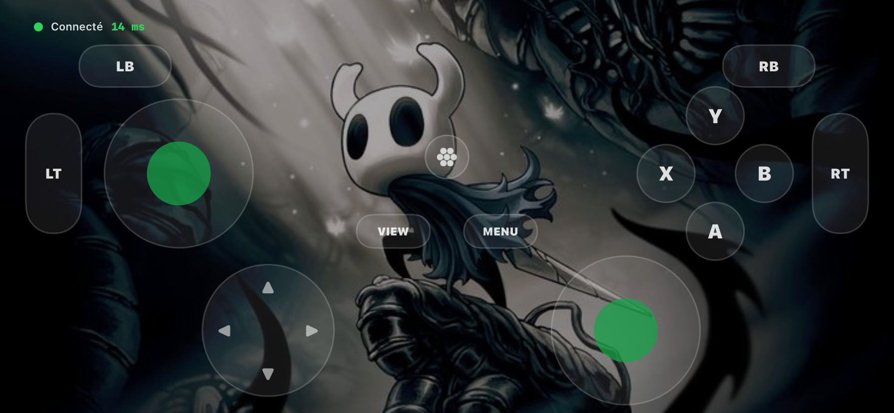
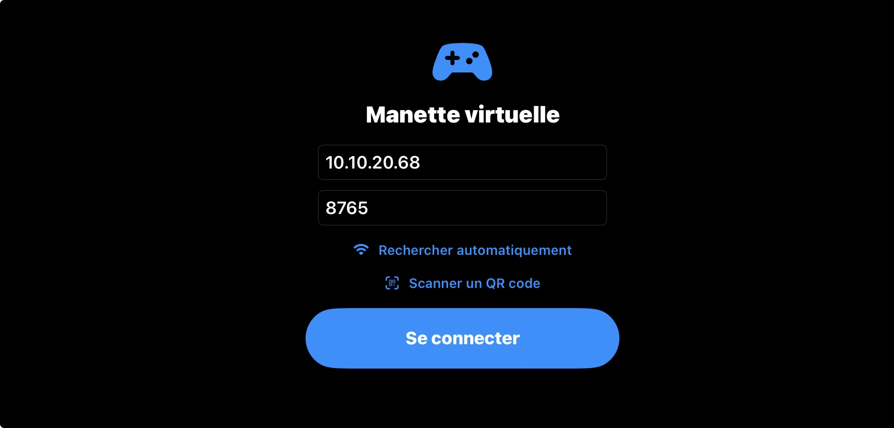
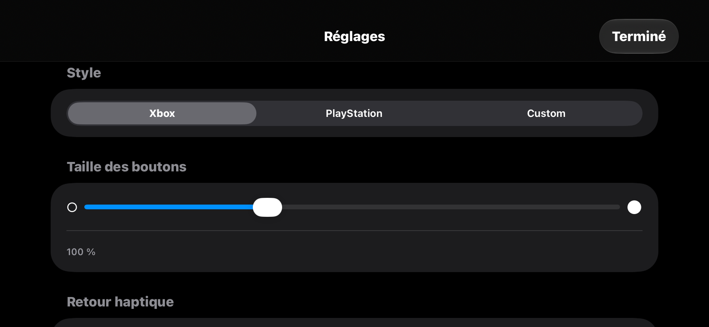

# Gamepad

Transforme ton iPhone en manette de jeu pour ton PC Linux.

<p align="center">
  
</p>

<p align="center">
  
  
</p>

## Installation de l'app

Télécharge le dernier fichier `.ipa` dans la page [Releases](../../releases), puis installe-le avec [SideStore](https://sidestore.io) ou [AltStore](https://altstore.io).

## Installation du serveur

Télécharge d'abord ce dépôt : `git clone https://github.com/kelian-4/gamepad`

### NixOS

1. Copie le module NixOS dans ta configuration : `sudo cp gamepad/nixos/module.nix /etc/nixos/gamepad.nix`
2. Dans `/etc/nixos/configuration.nix`, ajoute le module et active-le :

```nix
imports = [ ./gamepad.nix ];
programs.gamepadServer.enable = true;
```

3. Applique la configuration : `sudo nixos-rebuild switch`

### Autres distributions Linux

```
cd gamepad
python3 -m venv .venv
.venv/bin/pip install -r server/requirements.txt
sudo modprobe uinput
```

## Lancer le serveur

Dans le dossier du dépôt.

NixOS :

```
sudo gamepad-server server/gamepad_server.py
```

Autres distributions :

```
sudo .venv/bin/python server/gamepad_server.py
```

Un QR code s'affiche dans le terminal.

Note : le serveur n'a été testé que sur NixOS. Si un problème survient sur une autre distribution, ouvre une [issue](../../issues).

## Se connecter

Téléphone et PC sur le même Wi-Fi, puis dans l'app : « Scanner un QR code » (ou « Rechercher automatiquement », ou saisie de l'adresse à la main).

## Contribuer

Voir [`CONTRIBUTING.md`](CONTRIBUTING.md). Les portages vers Android sont acceptés s'ils sont open source sous la même licence et partagés avec le projet.

## Licence

[GNU GPL v3](LICENSE).
